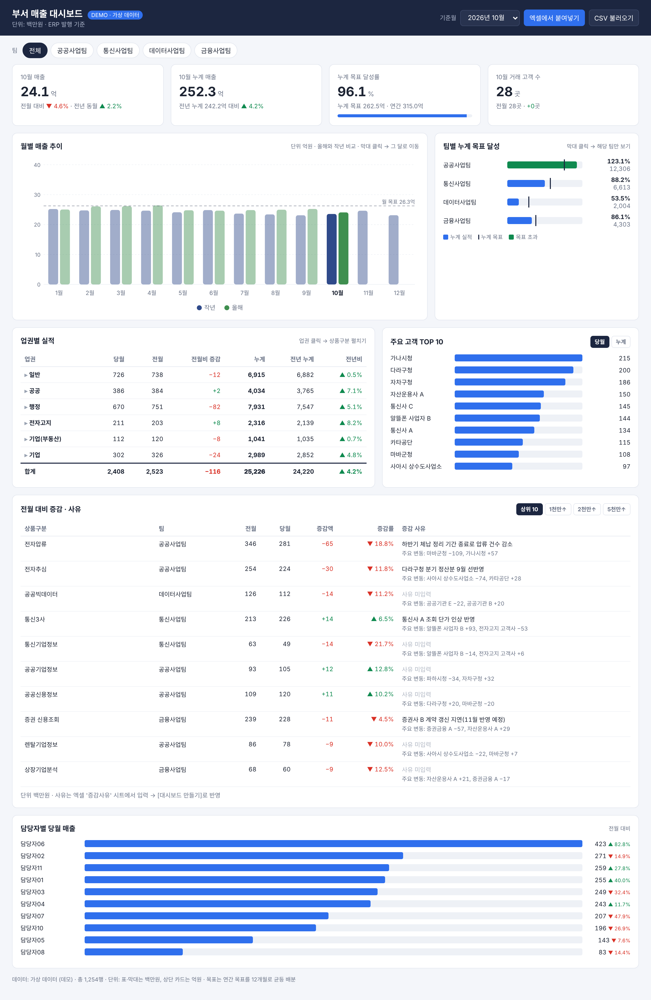

# 부서 매출 원장 · 자동분류 · 대시보드

매달 매출 시스템에서 내려받은 개별화된 매출 실적을 엑셀 원장에 쌓고,
상품명 → 상품구분 → 팀 / 업권으로 자동 분류해 월별 집계·팀별 관리현황·HTML 대시보드로 보여줍니다.

> **월 마감 작업 약 1시간 → 5분** 

> ※ 저장소의 모든 데이터(팀·고객명·담당자·금액·분류 기준)는 가상 샘플입니다.

## 왜 만들었나

매달 부서 매출현황을 만드는 데 시간이 오래 걸렸고, 결과를 믿고 쓰기도 어려웠습니다.

**1. 분류가 사람 손에 달려 있었다**
- 2000여개의 개별 매출의 상품명은 같은 상품명이라도 업계, 담당자(내부/외부), 고객에 따라 다른 상품구분과 다른 팀으로 나뉩니다.
- 그래서 매달 수천 건을 한 줄씩 보며 분류해야 했고, 기준은 담당자의 경험에만 남아 있었습니다.

**2. 기준이 코드 안에 숨어 있었다**
- 이전 자동화(VBA)는 조건이 코드에 직접 적혀 있었습니다. 상품이나 기준이 바뀌면 코드를 고쳐야 했고, 작성자 말고는 손대기 어려웠습니다.

**3. 맞는지 확인할 방법이 없었다**
- 분류된 합계가 원본 총액과 같은지, 빠진 건이 없는지를 눈으로 대조했습니다.
- 어떤 고객이 어느 상품구분에 들어갔는지 추적하기 어려워, 숫자가 다를 때 원인을 찾는 데 시간이 걸렸습니다.

**4. 보는 사람이 읽기 어려웠다**
- 숫자가 빽빽한 엑셀 표라서, 이번 달이 좋은지 나쁜지, 왜 변했는지를 바로 알기 어려웠습니다.
- 증감 사유도 증감 큰 상품을 직접 찾아서 써야 했습니다.

## 무엇이 바뀌었나

| 항목 | 기존 | 개선 후 |
|---|---|---|
| **월 마감 작업 시간** | 약 1시간 | 약 5분 |
| 분류 방식 | 상품·고객을 보며 수작업 분류 | 규칙표 기반 자동 분류 (2,000여 건 즉시) |
| 기준 변경 대응 | VBA 코드 수정 (작성자만 가능) | 규칙표에 한 줄 추가 (누구나 가능) |
| 검증 | 합계를 눈으로 대조 | 원장 총액 vs 분류 합계 자동 대조, 미분류 0건 확인 |
| 누락·오분류 발견 | 보고 후 발견되는 경우 있음 | 미매핑·규칙중복 건 자동 표시 |
| 원인 추적 | 합계만 있어 추적 어려움 | 고객·상품 단위 기존 대비 비교 자동 |
| 증감 사유 | 증감 상품을 직접 찾아 작성 | 기준 금액 이상 상품 자동 추출 + 주요 변동 고객 표시 |
| 보고·공유 | 엑셀 파일 전달 | 대시보드 HTML으로 공유 |

### 작업 흐름

| 기존 | 개선 후 |
|---|---|
| 1. 매출 실적 내려받기 | 1. 매출 실적 붙여넣기 → 자동 분류 |
| 2. 상품명·업계·담당자를 보며 한 줄씩 분류 | 2. 차이 = 0, 미분류 0건 확인 |
| 3. 팀별 시트에 옮겨 적기 | 3. 증감사유 만들기 → 사유만 입력 |
| 4. 상품구분별 합계 계산·대조 | 4. 대시보드 만들기 → 공유 |
| 5. 증감 큰 상품 찾아 사유 작성 | |
| 6. 보고용 표 정리 | |

### 기대 효과
- **시간:** 월 1시간 → 5분, 약 92% 단축 · 연간 약 11시간 절감
- **정확도:** 실데이터 검증 결과 금액이 기존 보고와 일치했고, 총액 차이는 0.7%. 이 차이는 데이터를 내려받은 시점 차이
- **지속성:** 담당자가 바뀌어도 규칙표와 인수인계서로 같은 기준을 유지합니다.
- **확장성:** 전사 매출 관리로 확장할 수 있습니다.

## 구성

| 파일 | 역할 |
|---|---|
| `template.xlsm` | 원장 + 분류 기준 + 집계 + 팀별 피벗 |
| `PatternAnalysis.bas` | 과거 원장 학습, 수식 복구, 대시보드·증감사유 생성 VBA |
| `dashboard.html` | 단일 HTML 대시보드 (외부 라이브러리 없음, 오프라인 동작) |

## 화면

## 기술

- **Excel**: 표·구조적 참조, SUMPRODUCT 기반 규칙 점수 매칭, INDEX/MATCH, 조건부 서식, 데이터 유효성, 피벗 테이블
- **VBA**: 과거 원장 패턴 분석, 표 재생성·수식 일괄 설정, 피벗 자동 생성
- **HTML/JS**: 분석 차트, 엑셀 붙여넣기·CSV 파싱
- **Python**: 템플릿 생성 및 수식 검증

